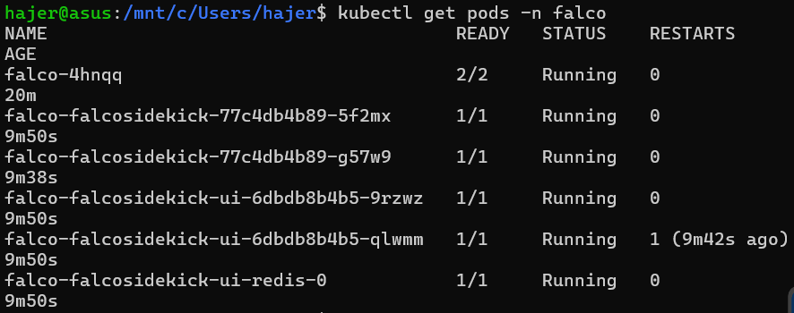
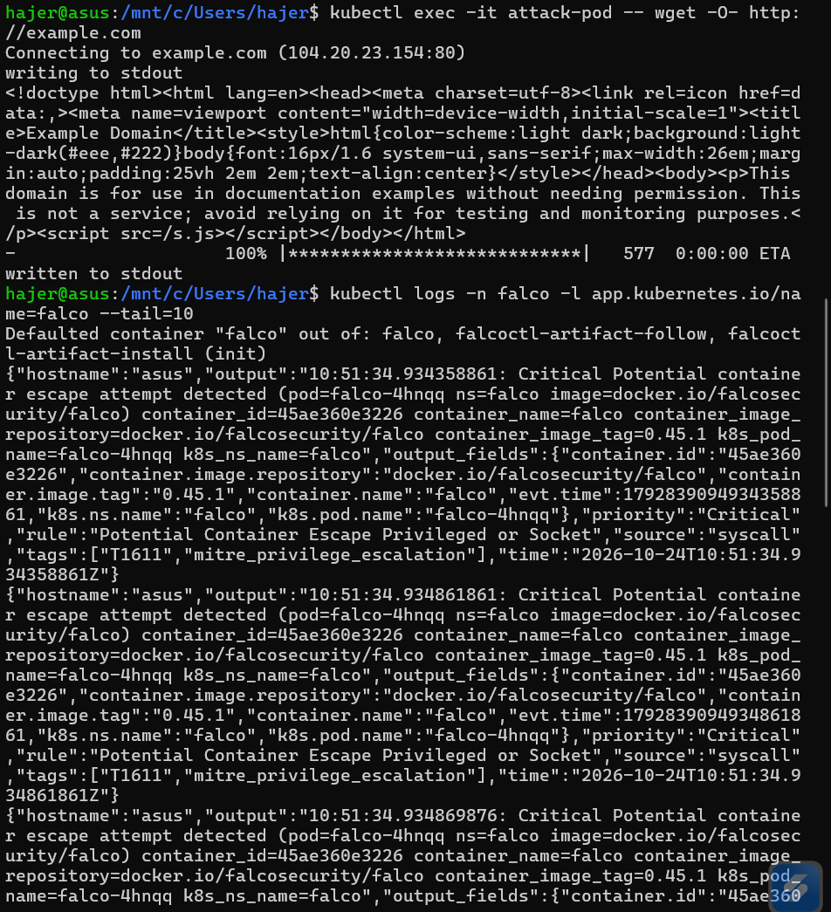
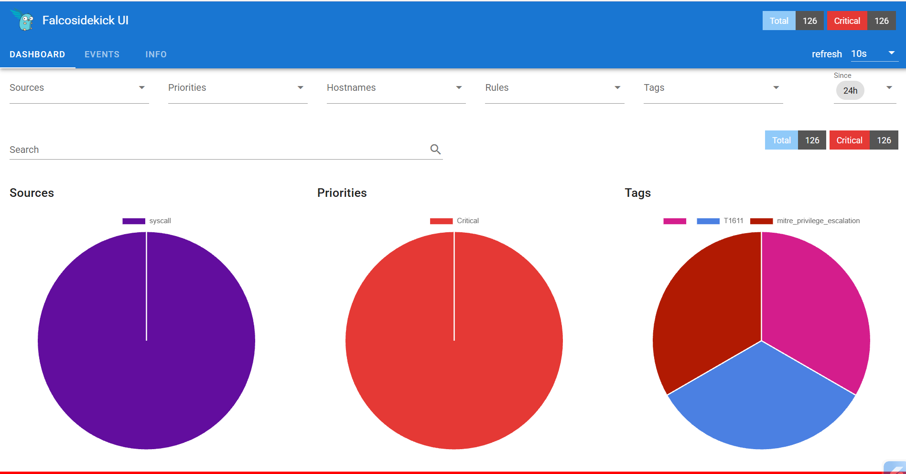

# 🛡️ K3s Runtime Threat Detection with Falco & MITRE ATT&CK

## 📋 Présentation du Projet
Ce projet met en œuvre une architecture de **Security Operations Center (SOC) Cloud-Native** légère et open-source pour assurer la sécurité et la détection runtime d'un cluster Kubernetes (K3s). L'objectif est d'intercepter en temps réel les comportements suspects au niveau du noyau Linux grâce au moteur **eBPF** de Falco, de centraliser les alertes via **Falcosidekick**, et de les visualiser sur un tableau de bord analytique.

---

## 🏗️ Architecture Technique
La chaîne de sécurité repose sur les composants suivants :
1. **Cluster Kubernetes (K3s sous WSL2)** : Environnement d'exécution local léger.
2. **Falco (modern_ebpf)** : Sonde de sécurité runtime au niveau du noyau pour capturer les appels système.
3. **Falcosidekick & Falcosidekick UI** : Collecteur, normalisateur et interface de visualisation graphique centralisée des alertes au format JSON.

### 📊 État du Cluster (Pods Actifs)

---

## 🎯 Scénarios d'Attaques & Matrice MITRE ATT&CK

Pour valider l'efficacité du système de détection, plusieurs simulations d'attaques ont été menées dans des pods isolés :

| Vecteur d'Attaque / Action | Outil / Commande | Règle Falco Déclenchée | Sévérité | Tactique & ID MITRE ATT&CK |
| :--- | :--- | :--- | :--- | :--- |
| **Exécution de Code** | `kubectl exec -it ... sh` | *A shell was spawned in a container* | Notice | Execution (`T1059`) |
| **Accès aux Secrets** | `cat /etc/shadow` | *Sensitive file opened for reading* | Warning | Credential Access (`T1003.008`) |
| **Transfert de Fichiers** | `wget http://example.com` | *Network Tool Spawned In Container* | Warning | Command and Control (`T1105`) |
| **Évasion / Privilèges** | Activité conteneurisée sensible | *Potential Container Escape* | Critical | Privilege Escalation (`T1611`) |

---

## 📸 Captures d'Écran & Preuves de Détection

### 1. Détection Runtime par le Noyau (Logs Falco)

*Exemple d'interception d'un comportement critique au niveau du noyau avec remontée des métadonnées contextuelles (Namespace, Pod, Tags MITRE).*

### 2. Tableau de Bord SOC (Falcosidekick UI)

*Visualisation globale des alertes de sécurité en temps réel, ventilées par priorités, sources et tags de la matrice MITRE ATT&CK.*

---

## 🚀 Compétences & Stack Démontrées
* **Sécurité Cloud-Native & Kubernetes** : Isolation, gestion des privilèges et durcissement des clusters.
* **Détection Runtime** : Utilisation avancée de Falco avec le pilote `modern_ebpf`.
* **Threat Intelligence** : Mapping des comportements malveillants sur le framework **MITRE ATT&CK**.
* **Ingénierie SOC** : Centralisation et visualisation des logs d'incidents via Falcosidekick UI.
